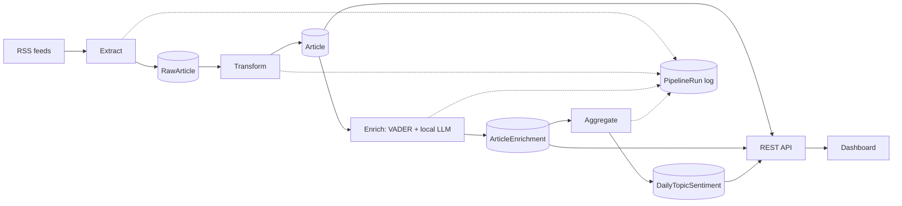

# News Sentiment & Topic Tracker

A data pipeline that collects news from RSS feeds, cleans and de-duplicates it, and uses a small local LLM (via Ollama) to tag each article with sentiment, topic, entities and a one-sentence summary. Results are stored in PostgreSQL, aggregated into daily trends, and served through a documented REST API and a browser dashboard.

Built with Python, Django, Django REST Framework and PostgreSQL. It runs entirely on one machine, with no paid services.

## Architecture



Design rules that the whole project follows:

1. **Raw data is never thrown away.** Bad records are marked `rejected` with a reason.
2. **Every stage can be re-run safely.** Running it twice gives the same result (idempotent).
3. **One bad feed or record never stops the rest.** Errors are caught, logged and recorded.

## Features

- **Extract:** six BBC RSS feeds, with timeouts, retries and duplicate protection (unique URL hash, tracking parameters removed).
- **Transform:** HTML stripping, UTC dates, validation rules and title-based de-duplication.
- **Enrich:** a VADER baseline plus a local LLM that returns JSON, which is validated with Pydantic. Invalid answers are retried, then marked failed.
- **Aggregate:** daily average sentiment and counts per topic.
- **API:** read-only endpoints with filtering, search, ordering, pagination and interactive OpenAPI docs.
- **Dashboard:** sentiment trends, articles per topic and the latest headlines.
- **Operations:** one command runs the whole pipeline, every run is recorded in `PipelineRun`, and logs rotate.
- **Quality:** automated tests with mocked HTTP and a fake LLM, query-count tests, ruff, and pre-commit hooks.

## Tech stack

| Area | Tools |
|---|---|
| Language | Python 3.12 |
| Backend | Django, Django REST Framework, django-filter, drf-spectacular |
| Database | PostgreSQL (psycopg) |
| Ingestion | requests, feedparser, BeautifulSoup |
| NLP | VADER, local LLM through Ollama (`qwen2.5:0.5b`), Pydantic |
| Frontend | Plain HTML and JavaScript, Chart.js |
| Quality | pytest, pytest-django, factory-boy, responses, ruff, pre-commit |

## Quick start

Requires Python 3.11+, PostgreSQL, and (for the LLM stage) [Ollama](https://ollama.com).

```bash
git clone git@github.com:nehapawar20/news-sentiment-tracker.git
cd news-sentiment-tracker

python -m venv .venv
source .venv/Scripts/activate        # Windows (Git Bash); macOS/Linux: source .venv/bin/activate
pip install -r requirements/dev.txt

cp .env.example .env
```

Edit `.env`. Create a secret key with:

```bash
python -c "import secrets; print(secrets.token_urlsafe(50))"
```

Create the database (in `psql`, choose your own password):

```sql
CREATE USER newsuser WITH PASSWORD 'change-me';
ALTER USER newsuser CREATEDB;
CREATE DATABASE newstracker OWNER newsuser;
```

Set up and run:

```bash
python manage.py migrate
python manage.py seed_sources
python manage.py createsuperuser
python manage.py run_pipeline --skip-enrich   # fetch, transform, aggregate (no LLM)
python manage.py runserver
```

Open the dashboard at http://127.0.0.1:8000/, the API docs at http://127.0.0.1:8000/api/docs/ and the admin at http://127.0.0.1:8000/admin/.

### Optional: the LLM stage

```bash
ollama pull qwen2.5:0.5b              # about 400 MB
python manage.py run_pipeline --enrich-limit 20
```

If Ollama is not running, the enrich stage fails safely, aggregation still runs, and the command exits with an error code.

## Pipeline commands

| Command | What it does |
|---|---|
| `seed_sources` | Creates the default RSS sources (safe to repeat) |
| `fetch_articles` | Downloads articles into `RawArticle` |
| `transform_articles` | Cleans, validates and de-duplicates into `Article` |
| `enrich_articles --limit N` | Adds sentiment, topic, entities and summary with the LLM |
| `aggregate_daily --days N` | Recomputes daily topic sentiment |
| `run_pipeline` | Runs all four stages in order with a failure policy |
| `export_eval_sample`, `label_sample`, `evaluate_sentiment` | Evaluation tools (see below) |

`run_pipeline` stops if fetch or transform fails. If enrich fails, it still aggregates the data that is already enriched.

## API

Interactive docs: `/api/docs/`

| Endpoint | Purpose |
|---|---|
| `GET /api/v1/articles/` | Articles with filters (`topic`, `sentiment_label`, `source`, `published_after`, `published_before`), `search`, `ordering`, `page_size` |
| `GET /api/v1/articles/{id}/` | One article |
| `GET /api/v1/topics/` | Counts and average sentiment per topic (`from`, `to`) |
| `GET /api/v1/trends/` | Daily sentiment series (`topic`, `from`, `to`) |
| `GET /api/v1/pipeline-runs/` | History of pipeline runs |
| `GET /api/v1/health/` | Database check and last successful run per stage |

The API is read-only. Invalid parameters return a clear `400` error.

## Testing

```bash
pytest --cov                  # tests with coverage
bash scripts/check.sh         # ruff, format check and tests
pre-commit install            # run ruff and basic checks before every commit
```

The suite has 251 tests and about 88% coverage. External services are mocked: HTTP with `responses` and the LLM with a fake client, so the tests need no internet and no Ollama.

## Project structure

```
config/        Django settings and URLs
news/          models, admin and the REST API (news/api/)
pipeline/      extractors, transformers, enrichment (LLM), aggregation,
               evaluation helpers, PipelineRun model and management commands
dashboard/     the dashboard page and its static files (Chart.js)
tests/         automated tests, factories and fixtures
docs/          requirements, architecture, data quality, evaluation, SQL queries
evaluation/    the hand-labelled evaluation sample
scripts/       check.sh and a Windows batch file for running the pipeline
requirements/  base and development dependencies
```

## Evaluation

I labelled 50 random articles myself and compared each method with my labels (full details in `docs/evaluation.md`).

| Method | Accuracy |
|---|---|
| Always guess the most common label | 56.0% |
| VADER (rule-based baseline) | 60.0% |
| Local LLM, prompt v1 | **74.0%** |
| Local LLM, prompt v2 | 69.4% (49 answered) |

Prompt v2 added more rules and examples but did not improve accuracy, so v1 stayed active. In the first enrichment batch, 5 of 20 articles got no valid answer because the model invented topics outside the allowed list. Both methods are weakest on neutral articles.

## Limitations

- The evaluation has only 50 articles, so differences of a few points are not conclusive.
- One labeller, and sentiment is partly subjective. [If you used help for some labels, say so here.]
- Prompt v2 was tuned on the same articles it was measured on.
- A 0.5B model is small. It is chosen to fit a laptop with 4 GB of RAM, not for best accuracy.
- Only headlines, short descriptions and links from public BBC RSS feeds are stored. This is a learning project.
- The Django development server is used. It is not set up for production.

## Future work

- Compare larger local models, and test on a held-out sample.
- Add Docker and GitHub Actions CI.
- Schedule the pipeline automatically.
- Add more sources and topic-level alerts.

## License

MIT. See `LICENSE`.
