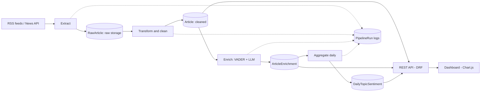
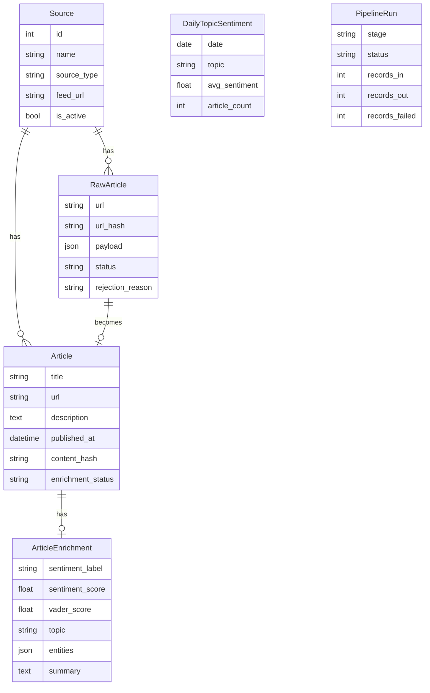

# Architecture

## Pipeline

## Stages

**Extract.** Input: active sources (RSS feed URLs). Output: one `RawArticle` row per feed entry, stored exactly as fetched. Failure behaviour: a failing feed is logged and skipped so other feeds still run. Duplicates are ignored using a unique URL hash.

**Transform.** Input: `RawArticle` rows with status `new`. Output: cleaned `Article` rows (HTML stripped, UTC dates, content hash). Failure behaviour: invalid records are marked `rejected` with a reason, never deleted.

**Enrich.** Input: `Article` rows with enrichment status `pending`. Output: an `ArticleEnrichment` row with VADER score, LLM sentiment, topic, entities and summary. Failure behaviour: invalid LLM output is retried a limited number of times, then the article is marked `failed`. A daily cap limits cost.

**Aggregate.** Input: enriched articles. Output: one `DailyTopicSentiment` row per date and topic. Failure behaviour: re-running overwrites the same rows, so the result is the same each time.

**Serve.** The REST API reads from the tables above and the dashboard calls the API. Nothing is written through the API.

**Monitor.** Every stage writes a `PipelineRun` record with status, counts and any error message.

## Data model

